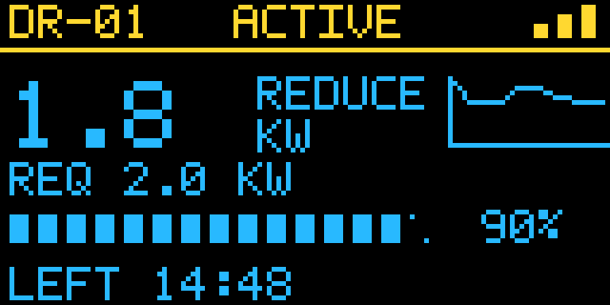

# DR SSD1306

A Python, MIT-licensed demand-response demonstration with a web control panel
and a graphical **128 × 64 SSD1306** display. It runs on a workstation without
hardware, or drives an I²C OLED on a Raspberry Pi. All DR and power values are
simulated; the project does not dispatch requests to real equipment.

It is also an RTI-FSP plugin for the
[iec61850-websocket](https://github.com/netbeheer-nederland/iec61850-websocket) rti-demo, like its sibling
[dr-st7789v](../dr-st7789v): an FSP connects to it, and the SO's IEC 61850 power limit starts, changes and ends
the DR event on the OLED (see [RTI-FSP integration](#rti-fsp-integration-iec61850-websocket-rti-demo)).



## Quick start — no hardware required

Requires Python 3.11 or newer and [uv](https://docs.astral.sh/uv/getting-started/installation/). uv creates and
manages the project's virtual environment; `uv sync` also installs the test tools.

```bash
uv sync
uv run dr-ssd1306 serve --simulate
```

Open **http://127.0.0.1:8080**. In the control panel:

1. Set the request, baseline, simulated demand, duration and schedule delay.
2. Click **Save & apply**.
3. Click **Activate now** or **Schedule**.
4. Change simulated demand and save to demonstrate a changing response.
5. Use **Lose demo link** / **Restore demo link** to demonstrate stale telemetry.

Example: baseline **5.0 kW**, simulated demand **3.2 kW**, requested reduction
**2.0 kW** gives a delivered reduction of **1.8 kW**, or **90%** of the request.
Demand above baseline gives zero delivered reduction. Values above 100% are
reported; the response bar saturates at 100% and the tiny screen's label caps
at 999%. The JSON API retains the uncapped percentage.

The graphical screen has a status header, a large reduction/capacity value,
a recent demand trend, the request, a response bar and a countdown.
Ready shows available capacity (represented by the requested setting),
Scheduled shows the request, Active shows delivered reduction, and Done shows
the time-weighted average delivered reduction. Ready/scheduled demand in the
sparkline is the baseline; active/done demand uses the manually configured
simulated demand. It is an illustrative trend sampled once per second, not
a metered history or a market settlement calculation.

### Docker (linux/amd64 and linux/arm64)

[`docker/Dockerfile`](docker/Dockerfile) builds one image for both architectures, from the repository root. The
`pi` extra is pure Python, so every image can drive the OLED. Build and push a multi-arch image with
[buildx](https://docs.docker.com/build/building/multi-platform/):

```bash
docker buildx build -f docker/Dockerfile --platform linux/amd64,linux/arm64 -t <registry>/dr-ssd1306:0.2.0 --push .
```

Or build for the local machine only and run the simulation:

```bash
docker build -f docker/Dockerfile -t dr-ssd1306 .
docker run --rm -p 127.0.0.1:8080:8080 dr-ssd1306
```

With Docker Compose, [`docker-compose.yaml`](docker-compose.yaml) runs the simulation on port 8080, reachable
from the LAN (set `DR_BIND=127.0.0.1` to keep it local, `DR_SSD1306_PASSWORD` to protect the web controls), keeps
the settings in a named volume, and restarts it with the Docker daemon. On a Pi, add
[`docker-compose.pi.yaml`](docker-compose.pi.yaml) to drive the OLED on I²C bus 1:

```bash
docker compose up -d
I2C_GID=$(stat -c %g /dev/i2c-1) \
  docker compose -f docker-compose.yaml -f docker-compose.pi.yaml up -d   # on a Pi
```

The hardware mode in Docker has not been tested on a Pi.

### Logging

`serve` logs to stdout, the app's and uvicorn's lines in one format, at `LOG_LEVEL` (`critical`, `error`, `warning`,
`info`, `debug` or `trace`; default `info`), or `--log-level`, which wins. An unknown level gives `info`. Requests
polled all the time are logged at DEBUG, so at `info` they don't bury the rest: the browser page's `GET /api/state`
and `GET /api/screen.png`, the FSP's `GET /plugin/attached`, `GET /plugin/status` and Docker's `GET /health`. A
`POST /api/settings`, an action or a plugin call stays at INFO. With Docker Compose: `LOG_LEVEL=debug docker compose
up -d`. This follows the rti-demo's FSP (decision [0005](docs/decisions/0005-logging-like-the-fsp.md)).

### CLI screenshots

```bash
uv run dr-ssd1306 render --output screen.png                        # colour preview of an active event
uv run dr-ssd1306 render --action schedule --raw --output raw.png   # the one-bit frame the driver gets
```

## Raspberry Pi: physical I²C SSD1306

```bash
uv sync --extra pi
sudo raspi-config
```

Enable **Interface Options → I2C**, then restart if requested. For a typical
3.3 V-compatible four-pin module:

| OLED | Raspberry Pi physical pin | Signal |
| --- | --- | --- |
| VCC | 1 | 3.3 V, if supported by your module |
| GND | 6 | Ground |
| SDA | 3 | GPIO2 / I²C SDA |
| SCL | 5 | GPIO3 / I²C SCL |

Check your module's voltage requirements. Do not connect 5 V logic to Pi GPIO.
With `i2c-tools` installed, check the bus and grant the user device access:

```bash
i2cdetect -y 1
sudo usermod -aG i2c "$USER"
```

Log out and back in after changing group membership. Run the app as your
normal user:

```bash
uv run --extra pi dr-ssd1306 serve --hardware
```

In **Physical SSD1306 display**, adjust bus, address (commonly `0x3C` or
`0x3D`), contrast and rotation; save to reconnect the device. Hardware settings
apply live. The current frame is refreshed at 2 Hz. An I²C error is displayed
in the control panel, and the app retries every five seconds while web controls
remain available. The service's health route reports hardware errors separately
from web-server availability. This project currently supports **I²C, 128 × 64,
SSD1306**; it does not include an SPI backend or 128 × 32 layout.

### Colors

SSD1306 output is **one bit per pixel**. The browser supports white, blue and
fixed yellow/blue previews. On a yellow/blue panel the top 16 physical rows are
yellow and the remaining 48 are blue; these are physical emission colors,
not selectable RGB values. Rotation moves the image, while physical color
regions remain fixed. Use a color controller/display for arbitrary colors.

## Access from a phone or another computer

```bash
export DR_SSD1306_PASSWORD='choose-a-password'
uv run dr-ssd1306 serve --host 0.0.0.0 --port 8080
```

Open `http://<pi-or-workstation-ip>:8080` and sign in as **demo**, using the
password you configured. `/health` and the plugin API under `/plugin` need no
password: the Docker healthcheck and the RTI-FSP can't sign in (decision
[0004](docs/decisions/0004-fastapi-web-service.md)). The password comes from the environment and is
never stored in the settings JSON. Default access is loopback-only. This
web service is for a trusted local demo network. HTTP Basic credentials
are not encrypted by HTTP; use an HTTPS reverse proxy when transport security
is needed. It is not intended to be exposed directly to the public internet.
No external fonts, JavaScript libraries or CDNs are required by the UI.

## Persistent settings and timing

Defaults are saved on the first settings change at
`~/.config/dr-ssd1306/settings.json`. Use another path with `--config PATH`.
Invalid settings return a clear error, and writes replace the JSON atomically.
The server refuses a malformed startup config rather than silently discarding
it. Rename/fix that config to recover.

Every process restart begins in **Ready**, with the saved numeric/display
settings. It does not resume an activation. `--simulate` and `--hardware`
override and save the hardware-enabled setting. Duration and schedule-delay
edits configure the **next** activation; an already running event keeps its
deadline. Power/request edits apply immediately. Only one event runs at a time;
activating/scheduling again replaces the current event. Completed average is
time-weighted over the actual active interval, not a moving average.

The simulated DR communication link is distinct from the physical I²C link.
Losing the demo link freezes the displayed reduction and marks it stale, while
the event timer and simulation continue. This illustrates telemetry loss;
it is not an implementation of an equipment fallback or safety policy.

## HTTP API

| Method | Route | Result |
| --- | --- | --- |
| GET | `/` | Web control panel |
| GET | `/api/state` | Settings, event state, timing, trend and hardware status |
| GET | `/api/settings` | Current settings JSON |
| POST | `/api/settings` | Validate, persist and apply a partial settings object |
| POST | `/api/action` | Run one demo action |
| GET | `/api/screen.png` | Colorized 128 × 64 browser preview |
| GET | `/api/screen.png?raw=1` | Unrotated one-bit framebuffer sent to the driver |
| GET | `/health` | Server availability plus hardware status |
| | `/plugin/*` | The RTI-FSP plugin API ([plugin README](src/dr_ssd1306/plugin/README.md)) |

Writes require `Content-Type: application/json`. Browser writes must be
same-origin. If configured, Basic authentication protects all routes but `/health` and `/plugin/*`.

```bash
curl -u "demo:$DR_SSD1306_PASSWORD" \
  -H 'Content-Type: application/json' \
  -d '{"requested_kw":2.0,"baseline_kw":5.0,"demand_kw":3.2,"duration_seconds":900}' \
  http://127.0.0.1:8080/api/settings

curl -u "demo:$DR_SSD1306_PASSWORD" \
  -H 'Content-Type: application/json' \
  -d '{"action":"start"}' \
  http://127.0.0.1:8080/api/action
```

Actions: `ready`, `start`, `schedule`, `complete`, `link-lost`, `link-restored`.
Start/schedule requires a positive request and a restored demo link.

| Setting | Default | Range / options |
| --- | --- | --- |
| `event_id` | `DR-01` | 1–7 uppercase letters, digits, hyphens |
| `requested_kw` | 2.0 | 0–99.9, rounded to 0.1 kW |
| `baseline_kw` | 5.0 | 0–99.9, rounded to 0.1 kW |
| `demand_kw` | 3.2 | 0–99.9, rounded to 0.1 kW |
| `duration_seconds` | 900 | 1–5999 integer seconds |
| `schedule_delay_seconds` | 30 | 0–5999 integer seconds |
| `preview_palette` | `yellow-blue` | `white`, `blue`, `yellow-blue` |
| `hardware_enabled` | false | boolean |
| `i2c_bus` | 1 | 0–255 |
| `i2c_address` | 60 (`0x3C`) | 3–119 via API, common addresses in UI |
| `rotation` | 0 | 0 or 180 degrees |
| `contrast` | 160 | 0–255 |

## Development and build

```bash
uv sync
uv run pytest -q
uv build
```

`uv sync` installs the test tools from the `dev` dependency group (decision
[0002](docs/decisions/0002-pytest-in-a-uv-dev-group.md)). Tests use a fake clock and a fake display and run without
hardware. They cover timed activation, scheduling, average response, link loss, validation, persistence, one-bit
and colour rendering, hardware recovery, HTTP controls and authentication, logging, and the plugin API with a fake
FSP. The test that connects the rti-demo's FSP plugin host runs where `acsi_plugins` is installed:

```bash
uv run --python 3.13 --with ../iec61850-websocket/examples/rti-demo/modules/plugins pytest -q
```

`uv build` creates a source distribution and wheel in `dist/`, including the bitmap font and browser UI. The UI
needs no separate build step. Run `uv lock --upgrade` to intentionally update dependency versions, then rerun the
tests and commit `uv.lock`. Hardware installations should keep `--extra pi` on `uv run`; a plain sync/run selects
only the base dependencies and may remove the extra from the environment.

Implementation decisions are in [`docs/decisions/`](docs/decisions/README.md).

```text
dr-ssd1306/
├── docker/
│   ├── Dockerfile               # multi-arch image (linux/amd64, linux/arm64)
│   └── Dockerfile.dockerignore
├── docker-compose.yaml          # the simulation, port 8080
├── docker-compose.pi.yaml       # adds the OLED on I²C bus 1
├── docs/
│   ├── decisions/               # implementation decisions
│   └── design/preview.png
├── playbooks/                   # rti-demo playbooks: DR simulations on the OLED, from the SO
├── src/dr_ssd1306/
│   ├── __init__.py
│   ├── server/                  # the display service
│   │   ├── cli.py               # serve/render entry points
│   │   ├── model.py             # settings, persistence, simulation engine
│   │   ├── render.py            # one-bit OLED frame and browser colour overlay
│   │   ├── glyphs.json          # built-in 5×7 bitmap font
│   │   ├── display.py           # I²C driver and recovery loop
│   │   ├── web.py               # web API, security checks, mounts the plugin API
│   │   ├── logs.py              # LOG_LEVEL, one log format, polls at DEBUG
│   │   └── static/index.html    # responsive browser controls
│   └── plugin/                  # RTI-FSP plugin API at /plugin: SO's DR requests on this OLED
└── tests/
    ├── conftest.py              # the fake clock
    ├── test_display.py
    ├── test_display_ssd1306_plugin.py
    ├── test_logs.py
    ├── test_model.py
    ├── test_render.py
    └── test_web.py
```

## RTI-FSP integration (iec61850-websocket rti-demo)

[`src/dr_ssd1306/plugin/`](src/dr_ssd1306/plugin/README.md) is a plugin for the rti-demo's RTI-FSP: the
rti-demo's plugin API, contract version 2, at `/plugin` of this service
([decision 0003](docs/decisions/0003-plugin-api-version-2.md)). An FSP connects to it from its plugin configuration,
`{"name": "display_ssd1306", "url": "http://<display>:8080/plugin"}`; nothing of it is installed in the FSP.
The SO's IEC 61850 Operate on `LD0/DWMX1.WMaxSpt` (power limit) below the baseline sets the requested reduction to
the difference and starts the event on the OLED; a limit at or above the baseline ends it. The association and the
FSP's stop restore and lose the OLED's DR link. The simulated power and the applied limit go back to the SO through
the FSP's reports.

[`playbooks/`](playbooks/README.md) has DR simulations run from the SO through SP01 with the rti-demo's playbook
runner, step by step on the HMI's Traffic page.

## References

- [Luma OLED driver API](https://luma-oled.readthedocs.io/en/latest/api-documentation.html)
- [SSD1306 controller datasheet](https://cdn-shop.adafruit.com/datasheets/SSD1306.pdf)

## License

MIT. See [LICENSE](LICENSE). The bundled bitmap font and UI are part of this project.
